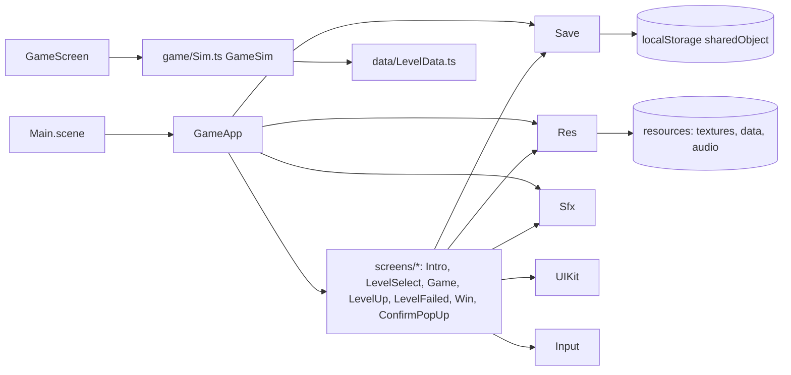
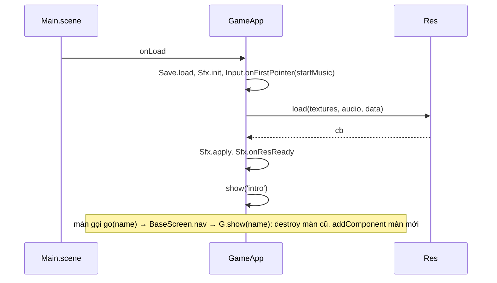
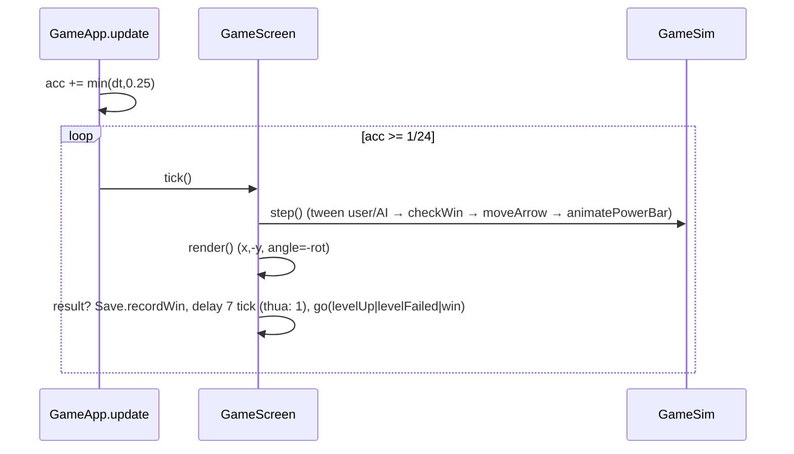

# Architecture

## Overview

Ghi chú: `core` import `screens` (GameApp) và `screens` import `core` (vòng ở mức thư mục, không vòng ở mức file nhờ `BaseScreen.nav`).

## Flows
### Boot và chuyển màn

### Một tick gameplay (24 fps)

### Bắn thuyền
Pointer down (inputLayer, dưới HUD) → `sim.pointerDown()` (dừng arrow, bật power bar) → pointer up → `sim.pointerUp()`: `power=scaleX*100`, `frms=ceil(25/10000*|v|²)`, xoay 3 tick rồi tween quad in-out; mỗi tick tween `checkCollision` (1 điểm mũi thuyền vs mask) → trúng: lùi 1 `inc`, dừng.

## Data
| Thứ | Nơi | Ghi chú |
|---|---|---|
| `levels.json` | `resources/data` | `levels["1".."10"]`: user_ship, ai_ship (x,y,rot,regX,regY), user_target, ai_target, obstacle, aiPaths (2 danh sách), waypoints pN |
| `mask_NN.json` | `resources/data` | RLE `rows[y] = [start,len,...]`, 800×450 |
| Save | localStorage `sharedObject` | `{currentLevel, scores[1..10], musicVolume, sfxVolume, sfxOn, musicOn}` |
| Điểm | `Sim.score()` | `1000 + AI waypoint chưa đi × (100 + level×10)` |

## External
Không có network/SDK/env. `.mcp.json` trỏ MCP Funplay (chỉ dùng khi dev). Font: system bold (thiếu Passion One).
